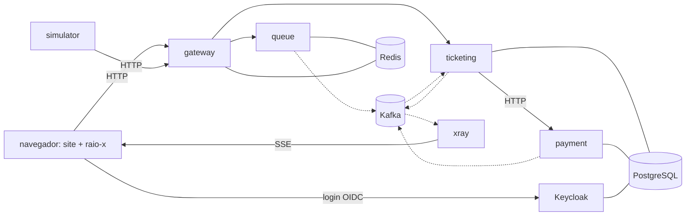
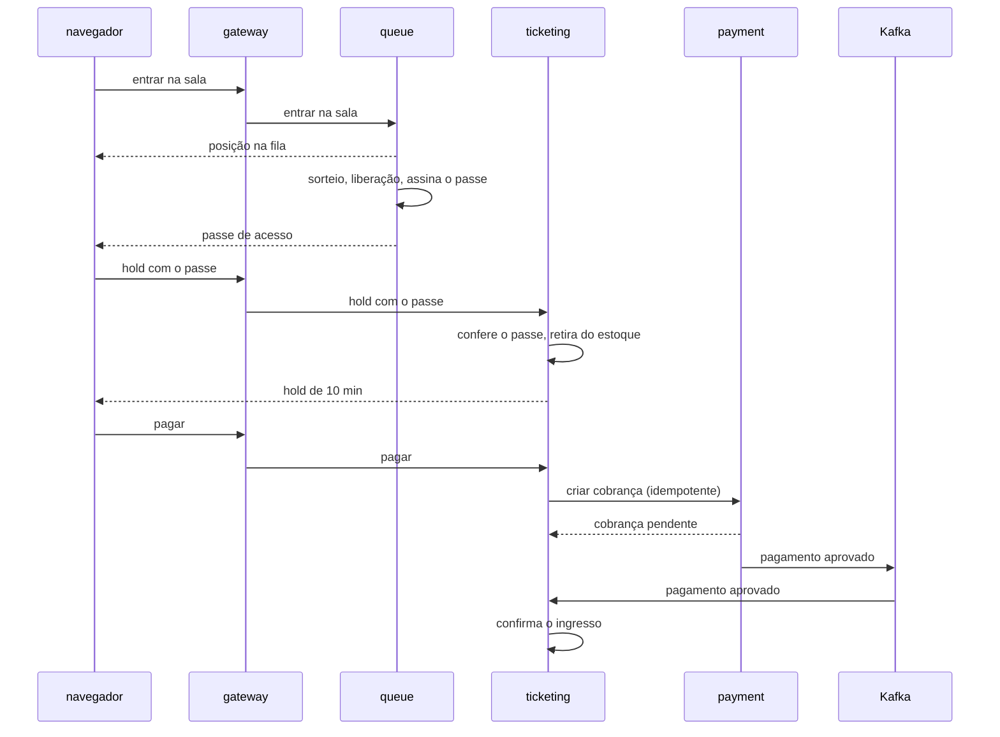

# System design do ticket-hit

Venda relâmpago de ingressos com fila virtual: milhares de pessoas querem poucos ingressos que abrem num horário marcado. O sistema decide quem entra, em que ordem e por quanto tempo, sem vender um ingresso a mais e sem deixar ninguém furar a fila.

O festival, os artistas e os compradores são fictícios. A identidade visual se inspira na estrutura de sites de festival, sem copiar marca, nome ou imagem de evento real.

## Demonstração

O visitante vê duas metades da mesma tela:

- à esquerda, o site do festival: home com line-up, página do show, sala de espera, fila e compra;
- à direita, o raio-x: o que cada serviço do backend faz naquele instante.

Fluxo da visita:

1. O visitante clica no banner do artista e entra na sala de espera de um show criado só para ele.
2. Cerca de 1.000 bots entram na mesma sala. Os bots fazem requisições reais à mesma API que o visitante usa.
3. Na abertura, o sorteio define a posição de cada um e a fila começa a andar, com o relógio da demo acelerado.
4. Quando o visitante é liberado, o formulário de compra se preenche sozinho com dados fictícios e o botão "Comprar" é habilitado.
5. Se ele clicar antes de o estoque acabar, compra. Se demorar, vê "esgotado".
6. O resultado compara o visitante com os bots: a ordem da compra dele ("você levou o ingresso 442 de 500"), o tempo entre o botão habilitado e o clique, e o tempo médio dos bots. Quem perdeu vê quanto tempo faltou.
7. No fim, um replay mostra a linha do tempo do que aconteceu no backend.

A ordem da compra e os tempos são medidos no servidor, a partir do hold e do pedido de compra, e não pelo relógio do navegador.

Regras da demonstração:

- Um aviso discreto e permanente informa que é uma simulação e que nada é cobrado. Como o formulário se preenche sozinho, ninguém digita dado pessoal ou cartão real.
- O raio-x mostra eventos emitidos de fato pelos serviços. Há dois modos alternáveis: narrado (eventos exibidos com atraso e legenda) e bruto (tempo real). O modo inicial é o narrado.
- Cada visitante tem uma sala privada. Quando a máquina atinge o limite de salas simultâneas, o visitante seguinte espera numa fila de entrada da própria demo.
- No celular, o site ocupa a tela e o raio-x fica numa gaveta inferior com posição na fila, estoque, bots ativos e o último evento. Arrastar a gaveta para cima abre o raio-x completo.

Controles do raio-x:

- Modo sem proteção: a sala roda a venda com a estratégia ingênua (ler o estoque, conferir na aplicação, gravar). O raio-x mostra o estoque ficando negativo e mais ingressos vendidos do que existem. Ao religar a proteção, a mesma carga termina com estoque zero.
- Botão de caos: derruba um serviço só da sala do visitante, nunca da máquina inteira. Com o `payment` fora, o pagamento fica pendente e é retomado sem cobrança duplicada; com a `queue` fora, quem já tem passe continua comprando.
- Link para o código: cada tipo de evento aponta para a linha do repositório que o produz.
- Bots abusivos: parte dos bots tenta forjar o passe, reaproveitar o passe de outro comprador ou estourar o rate limit. As tentativas aparecem bloqueadas no raio-x.

## Jornada do comprador

```
sala de espera -> abertura e sorteio -> fila com posição -> liberação com passe
  -> hold dos ingressos (10 min) -> pagamento -> ingresso confirmado
                  |
                  +-> hold expirado ou desistência: ingressos voltam ao estoque e a fila anda
```

Quem entra na sala de espera antes da abertura participa do sorteio. Quem chega depois da abertura entra no fim da fila, por ordem de chegada.

## Requisitos

Funcionais: entrar na sala de espera, ver a posição, ser liberado, segurar ingressos, pagar, ter o hold expirado, ver o show esgotado.

Não funcionais:

| Requisito | Critério |
|---|---|
| Correção | o estoque nunca fica negativo nem vende acima do total, com qualquer número de instâncias |
| Justiça | a ordem da fila é respeitada, cada conta ocupa um lugar e o passe de acesso não pode ser forjado |
| Carga | a entrada na fila absorve o pico; a compra é limitada pela taxa de liberação |
| Segurança | autenticação obrigatória, passe assinado, rate limit e bloqueio de comportamento abusivo |
| Custo | o sistema inteiro roda em nuvem gratuita |

A fila existe para proteger o estoque. Quem limita quantas pessoas compram ao mesmo tempo é a taxa de liberação. Por isso a compra pode ser simples e a fila precisa aguentar o pico.

## Serviços



| Serviço | Responsabilidade | Estado |
|---|---|---|
| `gateway` | porta única: roteamento, validação do JWT, rate limit | Redis |
| Keycloak | cadastro, login e emissão de tokens OIDC | PostgreSQL |
| `queue` | sala de espera, sorteio, posição, taxa de liberação, emissão do passe | Redis |
| `ticketing` | estoque, hold, expiração, compra | PostgreSQL |
| `payment` | pagamento falso que atrasa e falha de propósito e confirma por evento | PostgreSQL |
| `simulator` | cria a sala da demo e conduz os bots pela API | nenhum |
| `xray` | consome eventos de todos os serviços e entrega ao navegador por sala | nenhum |
| `web` | site do festival e raio-x | nenhum |

## Dados

Os dados ficam separados pelo tipo de garantia que exigem.

- Estado quente, que muda milhares de vezes por segundo e pode ser reconstruído: fila, posições, contadores, rate limit. Fica no Redis.
- Estado que não pode se perder nem duplicar: estoque, reservas, pagamentos, contas. Fica no PostgreSQL.

Cada serviço é dono dos seus dados e nenhum lê a tabela de outro. Para caber na nuvem gratuita, há uma única instância de PostgreSQL com um banco e um usuário por serviço; o isolamento é garantido por permissão.

## Comunicação

- Comando é síncrono, fato é assíncrono. "Segure 2 ingressos" precisa de resposta imediata e vai por HTTP. "Pagamento aprovado" é um fato que outros serviços consomem pelo Kafka quando puderem.
- Kafka roda em modo KRaft, com um nó.
- Eventos de negócio usam o padrão outbox: o evento é gravado na mesma transação dos dados e publicado depois, para que uma queda entre o banco e o broker não deixe os dois inconsistentes.
- Eventos de telemetria para o raio-x são publicados direto. Perder um deles só apaga um ponto da animação.
- A chamada do `ticketing` ao `payment` tem timeout, retry e chave de idempotência, para que um retry não gere duas cobranças.
- O `ticketing` confere a assinatura e o prazo do passe sem consultar a `queue`. Quem já foi liberado continua comprando mesmo com a `queue` fora do ar.



## Segurança

- Login por OIDC no Keycloak. O `gateway` valida o JWT, e cada serviço valida de novo o que recebe.
- O passe de acesso é assinado pela `queue` e tem prazo curto.
- Rate limit por conta e por IP no `gateway`, com estado no Redis.
- Dados do formulário são gerados pela demo; nenhum dado pessoal real é coletado.
- Segredos ficam fora do repositório, em variáveis de ambiente.

## Raio-x

Cada serviço publica eventos de telemetria marcados com o identificador da sala e da requisição. O `xray` consome esses eventos, filtra por sala e envia ao navegador por Server-Sent Events. No modo narrado, o navegador segura os eventos num buffer e os exibe com atraso e legenda; no modo bruto, exibe à medida que chegam.

## Infraestrutura

- Desenvolvimento local com Docker Compose.
- Produção em máquina ARM do Oracle Cloud Always Free. Limites atuais e disponibilidade de capacidade a verificar na etapa de deploy.

## Decisões

| Tema | Escolha | Alternativa descartada | Motivo |
|---|---|---|---|
| Ordem da fila | sorteio antes da abertura, ordem de chegada depois | ordem de chegada pura | não premiar conexão rápida nem bot |
| Identidade | conta obrigatória antes da fila | anônimo com cookie | garantir um lugar e um limite por pessoa |
| Pagamento | serviço falso separado que atrasa e falha | simulado dentro da venda; sandbox de gateway real | exercitar timeout, retry e idempotência sem depender de terceiro |
| Divisão do backend | microsserviços desde o início | monolito modular | praticar comunicação entre serviços; custo aceito: mais RAM e problemas distribuídos desde o início |
| Estado da fila | Redis | PostgreSQL | não colocar o pico da fila no banco que guarda dinheiro |
| Broker | Kafka em KRaft, um nó | RabbitMQ; Redis Streams | padrão de mercado e log reprocessável para o replay |
| Identidade (implementação) | Keycloak | Spring Authorization Server próprio | não escrever nem manter o código de senha e token |
| Raio-x | SSE | WebSocket | o fluxo é só do servidor para o navegador |
| Sala da demo | privada por visitante, com bots | compartilhada entre visitantes | funciona sem ninguém mais no site |
| Celular | gaveta inferior e replay | abas; cartão flutuante | manter causa e efeito na mesma tela |

## Em aberto

- Nome do festival e identidade visual.
- Stack do `web`.
- Proporção de bots abusivos e tipos de ataque simulados.
- Texto da tela de resultado e tamanho do estoque da sala da demo.
- Fonte do replay: log do Kafka ou buffer do `xray`.
- Observabilidade: métricas e tracing.
- Aviso de esgotado para quem ainda está na fila.
- Estorno de pagamento aprovado depois que o hold expirou.

Decididos: Java 25, Spring Boot 4.1 e Maven; sorteio, liberação e passe na ADR 0007; limite de 4 ingressos por hold e um hold por passe.
